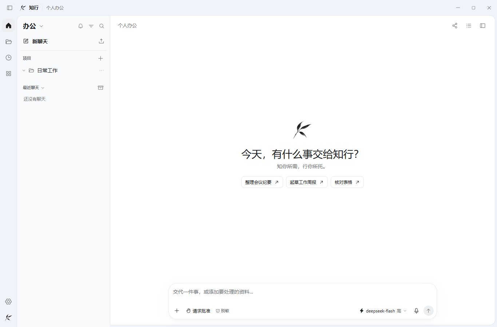
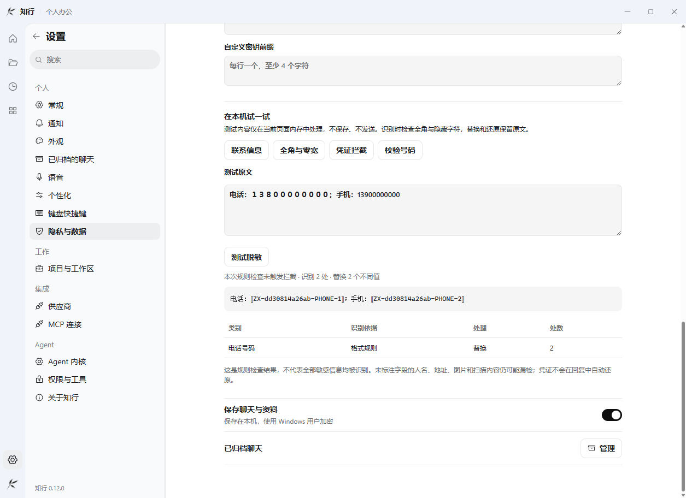

<div align="center">


<br />


# 知行 ZhiXing

**知你所需，行你所托。**

基于 DeepSeek Harness 的 Windows AI 办公工作台

把资料、交办、执行过程与成果，放在同一个项目里。

[下载与版本](https://github.com/daniei-chen/ZhiXing/releases) · [开始使用](#开始使用) · [能力与边界](#能力与边界) · [源码开发](#源码开发)

<br />

</div>

---

知行面向日常办公与政务材料处理。创建项目、选好资料，用自然语言交办一件事，再查看工具执行、核对来源、打开实际生成的文件。会话、项目目录、浏览器、终端和任务记录共同组成桌面工作台。

当前版本为 **0.13.6 Windows x64 未签名预发布版**，随包使用 **DeepSeek Harness 0.2.2-rc.5**。绑定工作目录的项目可调用原生文件工具，会话可从已保存的内核日志导出 Markdown，应用内可检查并下载更新，运行异常会写入本机诊断日志并可一键导出。 [下载完整安装包](https://github.com/daniei-chen/ZhiXing/releases/download/v0.13.6/ZhiXing-0.13.6-x64.exe) · [Windows 验收记录](docs/windows-acceptance-0.13.6.md) · [能力与缺口总览](docs/harness-capability-map.md#当前状态总览0134)

> 下面按版本倒序记录更新。**各版本章节里的「未覆盖」是当时的事实，可能已被后续版本补齐**；当前真实状态以[能力地图的当前状态总览](docs/harness-capability-map.md#当前状态总览0134)为准。

<div align="center">



知行 Windows 工作台 · 0.11.0 历史截图

</div>

## 0.13.6 本轮更新

- **`app.start` 增加 `previousVersion` 与 `updated`**：上次运行版本记在 `last-version.txt`，启动时比较并写回，日志能判断这次启动是否伴随版本变更。
- **新增 `update.install` 记录**（`{version, from}`）：此前点下「重启并安装」之后没有任何记录，无法判断是没触发还是没装成。
- **动机**：上一版改静默安装后撞上「一个版本没法用自己的包验证自己的更新修复」，这两个字段让更新是否成功在日志里可判读。
- **两个字段在真实更新场景下的输出尚未观测**：需要 `0.13.5` 检测到 `0.13.6` 并自行重启，发布后跑。

## 0.13.5 历史更新

- **自动更新的安装环节改为静默。** `quitAndInstall(false, true)` → `quitAndInstall(true, true)`。
- **为什么**：`0.13.4` 上实测发现整条链只差最后一环——检测 ✓、下载 308 秒 ✓、旧进程退出 ✓、exe 从 `0.13.3.0` 换成 `0.13.4.0` ✓，但**应用没有自动回来**。非静默模式让 NSIS 停在完成页等人点，自动重启因此失效。
- **本版改动在发布时尚未实机验证**：验证需要走「旧版检测到 0.13.5 并自行重启」，只能发布后跑。
- 静默安装看不到进度是取舍：进度由应用内的「正在下载／准备安装」承担。

## 0.13.4 历史更新

- **`unhandledRejection` 补上堆栈。** 此前只记 `message`，排查时等于只说「出错了」；`uncaughtException` 一直有堆栈，这里漏了。
- **四个崩溃记录点全部完成真实验证**：`uncaughtException`（inspector 注入）、`unhandledRejection`（注入未捕获拒绝）、`render-process-gone`（CDP 造真实崩溃）、`child-process-gone`（强杀进程树）。都不是「注册了监听器」的声明。
- 这是本版唯一的运行逻辑改动（源码指纹 `ebfae935…` → `0d1c3365…`）。
- **边界**：日志是事件级的，没有远程上报、crashReporter 与 minidump；验证的是「事件会落盘」，不是「现场可完整重建」。

## 0.13.3 历史更新

- **补了 4 个跨版本存档兼容性用例。** 自动更新铺开后每个老用户都要走升级路径，但此前从没测过「0.12.x 写的 `workspace.bin` 交给当前版本」。
- 覆盖：旧存档缺新增字段（补默认、用户数据原样保留）、未知新字段（安全忽略）、五种损坏存档（回退默认不抛错）、幽灵草稿（保留但不伪造归属）。
- **无运行逻辑改动**：包内生产源码指纹与 0.13.2 一致，只动测试与版本号。
- **真实升级演练（首次）。** 打包 `0.13.2` 连真实 GitHub：`available 0.13.3` → 下载 349 秒 → `downloaded`，缓存包 sha256 与发布资产完全一致。`quitAndInstall` 未执行（会替换正在运行的安装）。
- **生产环境证据。** 真实安装的 0.13.2 与 0.13.3 各一次：启动后 **46 秒**触发 `checking → current`，与 45 秒设计一致。
- **安装器行为（重要）。** 装到别的目录时，安装器会**先卸载同 appId 的既有安装**——隔离目录不构成隔离，任何安装器测试都会影响机器上现有安装。
- **边界**：兼容性是单元层面证明，不覆盖安装器替换、Electron profile 变化与 DPAPI 上下文；历史升级的安装器路径仍未跑。

## 0.13.2 历史更新

- **应用日志。** 此前没有任何日志文件。新增 `%APPDATA%\知行\zhixing\logs\app.log`，按行记录启动、更新状态、未捕获异常与子进程崩溃；1 MB 轮转保留两份；密钥类字段自动替换为 `[redacted]`，不写聊天正文与文件内容。
- **诊断导出。** 设置 → 关于 →「导出诊断信息」，生成 `diagnostics.json`（版本、平台、内存、数据量、更新与保存状态）加日志副本，可直接发给他人排查。
- **实测。** 日志单测 5/5（轮转测试抓出一个真实 bug——原实现把当前文件改名成 `.2`，导致 `.1` 永不存在）；诊断导出端到端通过，导出内容不含凭据。
- **上版 2 项超时取消复跑未复现**（323 项中 322 通过、0 失败、0 取消），按偶发处理。
- **未覆盖。** ~~未模拟真实崩溃~~ → 后续补齐：渲染进程用 CDP 导航到 `chrome://crash/` 制造真实崩溃并落盘 `render-process-gone`，主进程经 inspector 注入真实 `uncaughtException` 并落盘；`child-process-gone`／`unhandledRejection` 仍未触发。未接 crashReporter，不生成 minidump；日志明文存放（按设计不含敏感内容）。
- **安装生命周期已在本版复跑**：首次安装、同版本覆盖、卸载保留、重装保留、外部目录启动全通过，哈希与主机数据一致；历史升级因缺少匹配基线未跑。

## 0.13.1 历史更新

- **签名不再是硬编码。** 移除 `signExecutable: false`，无证书时构建器自动跳过（日志明确提示），设置 `CSC_LINK`／`CSC_KEY_PASSWORD` 后自动签名。证书仍未申请，签名成功路径**未经实测**，见 [签名说明](docs/signing.md)。
- **首次长时间运行观察。** 空闲 soak 29.8 分钟、54 次采样：内存 393.1→394.1 MB（+1 MB），句柄 2,313→2,390（+77），进程数恒为 4，CPU 近零。只覆盖空闲态，不能推断「无泄漏」。
- **目录包回归 2 项超时取消**（323 项中 320 通过、0 失败、1 跳过），取消项待定位。

## 0.13.0 历史更新

- **应用内自动更新。** 设置页可检查、下载、重启安装；启动后 45 秒后台查一次但不自动下载，安装必须点按钮。接入 `electron-updater`，`app-update.yml` 指向 GitHub 源。
- **安装包改名 `ZhiXing-0.13.0-x64.exe`**，与 `latest.yml` 的 `url` 一致（上版资产名含中文，更新器拼 URL 会出问题）。
- **实测。** 本地 feed 端到端跑通 `checking → available(0.99.0) → downloading(100%) → downloaded`；构建产物核对 `app-update.yml`、`latest.yml` 与 sha512 一致。
- **未覆盖。** 未从 GitHub 真实下载 338 MB 完整包，也未验证升级后的新版启动；安装包未签名，SmartScreen 提示仍在；安装生命周期未在本版复跑。

## 0.12.12 历史更新

- **工作区文件观察。** 打开文件面板时按项目目录建立监视，文件系统事件合批上报，面板自动刷新；关闭面板或切换项目即解除，应用重启后重建。能力地图里「跨启动文件观察」从缺口转为已接入。
- **两条端到端实测。** 运行期：外部写入到达一条合批事件，解除后不再送达。跨启动：关闭期间写入的文件重启后出现在列表，监视重建成功，重启后的新写入再次被观察。
- **边界。** 只监视当前项目目录，只通知「这里变了」，不做内容 diff；观察结果不会自动进入模型上下文，脱敏与审批链路不变。
- **安装生命周期本版复跑。** 首次安装、同版本覆盖、`0.12.11`→`0.12.12` 历史升级、卸载保留与重装保留全部通过；历史升级此前一直是缺口。准备过程中还发现 `0.12.10` 存在「外部写入后立即关窗会被渲染进程旧状态覆盖」的缺陷，未在本轮修复。

## 0.12.11 历史更新

- **首帧不再等自动化与服务。** 自动化状态初始化与建窗并行，浏览器、终端、语音服务改为窗口显示后后台准备；`automation:`、`browser:`、`terminal:`、`speech:` 通道在 `handle` 里统一等待就绪，退出时仍先等自动化再关闭。
- **实测约 100 ms、8%。** 空档案冷启动 10 次中位数：`initialise` 913 ms、窗口显示 1,044 ms、可交互 1,226 ms（0.12.10 为 1,017 / 1,131 / 1,281 ms）。两个版本未做同环境交替对比，该差异接近 Windows 启动噪声下限，只作方向参考。
- **边界。** 延迟只是把工作移出首帧，主线程的模块导入与同步解析照旧发生；要继续压缩启动需要拆分模块或引入编译缓存，而不是调整顺序。

## 0.12.10 历史更新

- **启动诊断。** 设置 `ZHIXING_STARTUP_TRACE=1` 后，主进程按阶段把启动耗时写到 stderr；`node scripts/probe-startup.mjs <应用路径> <次数>` 可在本机测量打包应用的启动中位数。实测 `initialise` 占启动约八成，其中模块导入与状态加载最多。
- **本轮没有可证实的提速。** 把 `initialise` 的十八个模块导入改成并行批次后，导入阶段从 173 ms 变成 1,072 ms，整体慢了约 240 ms，已回退并记录。同时修复 `config.json` 被解析两次，窗口改为在首帧显示、文档加载完成作为兜底。

## 0.12.9 历史更新

- **安装包体积。** 打包时移除运行时不会加载的内容：TypeScript 源码、source map、`@types` 类型声明、WebAssembly 版 OfficeKit 兜底，以及 `node-pty` 为 macOS、Linux 和 win32-arm64 提供的预编译二进制。Windows x64 的 OfficeKit 转换器、sharp、ripgrep、conpty、随包 Node 与许可证完整保留。应用目录从 1,454 MB 降到 818 MB，安装器从 562.8 MB 降到 322.8 MB；审批、脱敏、沙箱、图片与存储链路不变，完整回归与桌面旅程在裁剪后的真实包上通过。

## 0.12.8 历史更新

- **会话工作目录。** 绑定项目后，模型可以查看当前工作目录并切换到项目内已有子目录。相对路径的读取、写入、补丁和搜索都按该目录解析，尝试切到项目外会被拒绝；目录变更随会话保存，重开后继续生效。计划模式可以查看当前目录，但不能移动。执行轨迹显示「会话工作目录」，切换仍在项目和审批边界内。

## 0.12.7 历史更新

- **执行权限与内核预设同步。** 输入区的「请求批准／帮我批准／完全访问」现在固定为 Harness 原生执行权限预设，未绑定项目时使用只读。同一会话降档后，下一次命令立即使用新的工作区沙箱；会话历史里的预设事件与实际执行一致，内核设置显示本次诊断实际使用的预设。
- **图片资料支持 WebP 与 GIF。** 手动交办和项目内 `read_image` 接受单帧 WebP、GIF，与 PNG/JPEG 走同一条本机遮罩链：先转换并去除元数据的 PNG 副本，按当前规则遮罩本机 OCR 命中的文字，只有当前视觉模型收到副本。动图和多画面文件明确拒绝，不截取首帧。

## 0.12.6 历史更新

- **Agent 可使用 Harness 原生项目工具。** 在已绑定目录的项目中读取、搜索、编辑文件和应用补丁。文本写入和 Office 操作按当前执行权限审批。批量补丁中途失败时，保留已完成的文件修改，执行轨迹显示「未完成」。
- **项目图片沿用本机脱敏链。** `read_image` 读取 PNG/JPEG，默认用 Windows OCR 遮罩已识别且命中规则的文字。只有当前模型声明 `image` 输入时才发送经过主机核验的副本，保留已选供应商、模型与思考档位。手写、图表语义和 OCR 漏检仍需人工核对。
- **聊天可导出 Markdown。** 在会话菜单选择脱敏或非脱敏历史，审阅后保存 Harness 已提交的消息和工具记录。导出不调用模型，不还原旧占位符。主会话 Markdown 暂不包含子会话或附件字节。 [能力地图](docs/harness-capability-map.md)

## 0.12.5 历史更新

- **规划、目标和压缩直接作用于当前会话。** 主聊天和侧边聊天共用中英文命令。对话里的会话操作保留正在编辑的草稿。
- **Office 成果可从聊天打开。** 在关联工作目录的项目中可交办文档转换和工作簿重算。结果另存并在对话中登记。同名文件自动编号，源文件保留。逐次批准的桌面分发在 0.12.6 补齐。
- **模型可读取 Office 页面版式。** Windows 项目手动交办可按页码或工作表区域渲染。主进程处理页面上的已识别敏感文字，只有当前视觉模型可以接收批准的图片副本。 [能力地图](docs/harness-capability-map.md)

## 0.12.4 历史更新

- **模型接收实际像素。** 手动交办支持声明 `image` 输入的模型。知行保留选定的供应商、模型和思考强度。未声明图片能力时会拒绝发送并保留草稿。
- **先处理图片，再发送。** PNG/JPEG 在主进程按实际方向转换，移除元数据及透明区域中的隐藏像素。默认用 Windows OCR 的词框遮住命中规则和自定义词的文字。手动选择非脱敏模式时，像素不遮罩，已识别凭证及已配置的模型/MCP 密钥仍受阻断。
- **重启后核对同一份副本。** 图片字节通过当前隐私策略、MIME、大小及 SHA-256 核验后才允许出站。启用本地保存时，未发草稿关联的副本由 Windows 用户加密存储。重启后追问可以重放批准的同一副本。规则或凭证变化后，需在新会话中重新添加图片。

## 0.12.3 历史更新

- **图片资料真正进入 Agent 文件工具**：`office_read_file` 现在支持 PNG、JPEG、BMP 和 TIFF，调用 Windows 本机 OCR 后只把识别文字送入现有脱敏网关；原始图片字节不会进入模型请求。
- **规划状态与命令一致**：`/plan` 和 `/plan off` 会等待与命令相符的最终上下文投影，避免界面显示“已开启”而运行结果仍是关闭。
- **OCR 取消可传递**：停止资料读取会把 `AbortSignal` 传入 PowerShell 子进程，避免只在调用前后检查而留下继续运行的本机识别进程。
- **回归门禁进入正式入口**：OCR 回环测试、规划状态回归和包内测试已加入 `npm test`、组件/构建验证和 `test:packed`。

0.12.2 的锁恢复、目录分页、多份草稿恢复和能力状态清单仍保留在 [0.12.2 验收记录](docs/windows-acceptance-0.12.2.md)，不与本版安装包混用。

## 0.12.2 本轮更新

- **锁恢复可验证**：隐私映射主锁和 guard 在创建阶段崩溃后可以恢复，活进程、token、junction、坏 owner 和 Windows 删除中状态保持失败关闭；更新回调不会因重试重复执行。
- **目录结果完整**：`office_list_files` 支持分页、总数、续页和截断状态，121 项与 1,000 项目录可完整遍历，超过 10,000 项明确拒绝返回不完整结果。
- **多份草稿可找回**：多个未发送的新草稿显示在既有状态提示中，逐份恢复正文和附件。首次发送失败绑定实际聊天并原地恢复，删除项目后的迟到解析不会复活草稿。
- **能力状态真实可见**：Agent 内核设置读取实际工具目录和模型工具声明，显示注册、启用、当前可调度和阻断原因。PTC 的 `run_code` 与经程序调用的办公工具分开标示。
- **回归门禁进入正式入口**：新增测试已经加入 `npm test`、组件测试和包内测试，0.12.2 源码回归为 335 项，334 项通过，1 项因 Windows 文件符号链接权限条件跳过。

## 0.12.1 本轮更新

- **隐私边界一致**：两协议和 MCP 检查动态 JSON 键、工具 schema 属性与约束，敏感字段安全拒绝，保留工具语义；raw 仍拦截凭据。普通交办继续自动脱敏，不增加每次发送的重复确认。
- **交付由主机绑定**：TXT、DOCX、XLSX 和分享使用当前规则的审阅快照，绑定内容、策略、范围、动作和格式；旧 masked 不替代当前原文检查，renderer 不能注入另一份正文。
- **结果与退出分开**：内核退出未确认时保留会话隔离和恢复资料；自动化结果保存失败仍可读，独立重试只落盘，不重跑模型或工具。
- **失败与删除可恢复**：失败后原地恢复输入，保留终态轨迹；删除级联所属草稿和解析附件副本，按最新归属保留已移动聊天；资料去重追加，超限明确反馈。
- **独立插件链保留**：随包 npm 更新到 11.21.3，核对实际嵌套路径与组件清单。生产审计 high/critical 为零，仍有 moderate 告警及未覆盖供应链场景，详见验收说明。

## 0.12.0 已发布基线

- **真实内核接入**：原生 Agent Teams 支持共享任务、负责人、依赖与版本检查；原生 `run_code` 可编排工具，默认关闭，仅在绑定项目并选择完全访问时启用。两者已用真实 Harness 和本机合成模型服务验证，不是固定演示回复。
- **执行边界修复**：PowerShell 接入官方 Windows 写入沙箱；命令子进程清除内核秘密变量。修复主/子会话预览混流、非推理模型默认路由、429/503 重试、成果审批与规划模式检查顺序。Windows ACL 沙箱不代表隔离全部文件读取与网络。
- **本机脱敏增强**：全角与隐藏字符识别、结构化字段别名、身份证/Luhn/IBAN 校验、常见凭证和伪造占位符阻断。设置页提供合成样例、识别依据和处理动作。规则可能漏检，不宣称所有敏感信息均被识别。
- **独立插件运行时**：随包携带固定 npm CLI，插件版本探测和安装不再依赖开发机的外部 npm。安装脚本仍需单独审阅，安装或更新后默认停用。



以上工作台和隐私截图分别来自 0.11.0 和 0.12.0。各版本使用独立验收记录。 [0.12.0](docs/windows-acceptance-0.12.0.md) · [0.12.1](docs/windows-acceptance-0.12.1.md) · [0.12.2](docs/windows-acceptance-0.12.2.md) · [0.12.4](docs/windows-acceptance-0.12.4.md) · [0.12.5](docs/windows-acceptance-0.12.5.md) · [0.12.6](docs/windows-acceptance-0.12.6.md)

## 开始使用

### 安装 Windows 版

1. [下载 `ZhiXing-0.13.6-x64.exe`](https://github.com/daniei-chen/ZhiXing/releases/download/v0.13.6/ZhiXing-0.13.6-x64.exe)，核对 [SHA-256 清单](https://github.com/daniei-chen/ZhiXing/releases/download/v0.13.6/SHA256SUMS-release.txt)。
2. 安装并启动知行，在「设置 → 供应商」中连接模型服务，读取模型目录，选择模型与实际支持的思考档位。
3. 创建项目，在项目设置中绑定工作目录，添加需要处理的资料。
4. 写下交办内容，检查资料读取范围和执行权限，发送后查看执行过程与成果文件。

安装包包含 Node.js、Harness 和插件 npm CLI。Git 工作树需要本机 Git，部分 Office 技能需要额外的本机工具。SenseVoice 语音模型在用户主动准备时另行下载。当前安装包未签名，请核对来源与文件校验值。安装生命周期的结论限于验收记录所列条件。

[0.13.5 GitHub 发行页](https://github.com/daniei-chen/ZhiXing/releases/tag/v0.13.6)

| Windows x64 安装资产 | 值 |
| --- | --- |
| 文件 | `ZhiXing-0.13.6-x64.exe` |
| 发行状态 | Windows x64 未签名预发布版 |
| 文件大小 | `338,649,641` bytes |
| SHA-256 | `78cbab42f5353db622b7b3dc813b903a1744a11bc8d701683f4000aeb52e81b3` |

源码回归 **363/364**，目录包回归 **322/323**，各有 1 项因 Windows 文件符号链接权限跳过，0 失败、0 取消。组件 **14/14**，Sites **4/4**，Windows 目录包专项 **5/5**。桌面专项使用本机合成模型服务，核对了批准与拒绝后的实际文件字节、部分补丁的重启后轨迹、7 次模型出站，以及 Markdown 导出增加 0 次模型请求。 [0.13.4 Windows 验收记录](docs/windows-acceptance-0.13.6.md)

同一 Windows 账户的 NSIS 静默安装生命周期在 `0.13.2` 包上复跑：首次安装、同版本覆盖、卸载保留、重装保留与外部目录启动全部通过，项目／会话／草稿／加密配置哈希全程不变。`0.13.3` 另做了降级到 `0.13.2` 再升级回来的验证，数据文件哈希保持、升级后解密核对内容完整。**交互式安装全流程、跨账户解密、`quitAndInstall` 串联与真实云端仍未验证。**

发行页提供完整安装包、机器可读验收摘要、生产依赖路径清单、组件 SBOM、与 0.13.5 的完整 diff 和 SHA-256 清单。包内 `build-provenance.json` 记录实际构建源码提交 `671250eafb13371c8982df094b1de0131abe102d`。 [v0.13.6 源码](https://github.com/daniei-chen/ZhiXing/tree/v0.13.6) · [外部审计说明](docs/audit-request-0.13.6.md)

### 连接模型

支持 DeepSeek 原生路由，以及兼容 Chat Completions、Messages 的 API 服务。使用你自己的服务账号和 API Key，调用额度按供应商规则计算。供应商、型号和思考档位会在发送前再次校验，选择失效时保留草稿并提示重新选择。

切换供应商时新建聊天，避免把已有聊天历史自动交给另一家服务。不同供应商的同名模型独立显示与路由。真实云端服务的兼容性和输出效果需要使用相应账号验证。

### 交办与交付

从「添加」选择附件或项目资料，先确认提取结果。执行权限提供「请求批准」「帮我批准」「完全访问」，文件操作、网页、命令与 MCP 均受实际权限策略约束。

文件成果可从产出列表或项目文件面板打开。同名 Agent 写入使用新文件名另存，回执显示实际路径。会话支持复制与导出，分享前可审阅接收方版内容。「再次执行」会保留原问答并追加一次新的请求。

## 从一件具体的事开始

> 整理这份会议记录，列出已确定事项、负责人和截止时间，生成一份可编辑的纪要。

> 核对两份统计表的差异，保留原件，把需要人工确认的项目单独列出来。

> 阅读项目资料，起草本周工作简报，并在结果中保留资料来源和待补信息。

这些是交办示例。实际结果取决于所选模型、资料质量、本机工具和批准范围，生成内容需要人工核对。

## 一个项目，一处工作台

| 工作区域 | 可以做什么 |
| --- | --- |
| **项目与聊天** | 分项目保存资料、交办和草稿，在办公与政务模式之间切换。项目可绑定本机目录，并管理 Git 工作树 |
| **交办与执行** | 使用流式对话、规划、目标、问答和审批，查看子任务与后台作业的状态，停止执行并保留已经生成的正文 |
| **资料与文件** | 提取 DOCX、XLSX、PPTX 和文字 PDF，预览支持格式的版面，对扫描图进行本机 OCR，按需把文字加入交办 |
| **浏览器与终端** | 在右侧工作面板打开多标签网页、项目文件和真实 PTY 终端，通过侧边聊天处理另一项交办 |
| **产出与来源** | 从会话顶栏查看实际文件产出、附件和网页工具来源，预览成果，审阅后复制、保存或导出会话 |
| **定时任务与扩展** | 创建日历、间隔、Cron 或 RRULE 任务，审阅后启用，连接 MCP 工具与资源，管理 Harness 插件 |

会话顶栏保留三个入口，分别承载会话操作、产出与来源、右侧工作面板。浏览器、文件、终端、执行、产出、统计和详情都在工作面板内切换。

## 隐私与本机数据

**默认启用本机脱敏。** 文本、Windows OCR 结果和工具内容经过本机规则，映射按任务隔离。视觉请求发送处理后的像素副本，原文件字节和 EXIF 会被移除。零命中只表示识别结果未命中当前规则。手写、二维码、人脸、复杂扫描件、图表和 OCR 漏检仍需人工核对，全面 NER 尚未接入。设置支持分类控制、自定义词、排除词和本地测试。

| 数据或操作 | 处理方式 |
| --- | --- |
| 模型凭据 | 由 Electron 主进程使用 Windows 用户加密存储，渲染页面获取连接状态 |
| 会话与草稿 | 保存在本机加密工作区，保存失败持续提示并提供重试，恢复中断任务后由用户决定是否再次执行 |
| Office 与 PDF 输入 | 默认提取文字后加入上下文，界面保留隐藏区域、修订、公式缓存及未覆盖内容等读取说明 |
| 网页与终端 | 用户主动选择将网页文字加入交办，终端与网页浏览的上下文由各自入口管理 |
| 非脱敏模式 | 用户明确开启后普通信息保留原文；SECRET 强制拦截，已配置模型 Key 另作独立比较。可用模型 Key 至少 8 字符，旧过短 Key 要求重配 |
| 导出与分享 | 接收方版按当前策略处理；本人版保留普通信息但不绕过凭据和禁止规则，主机快照失效后需要重新审阅 |
| MCP 与插件 | 连接凭据按目标身份绑定，目标变化后要求重新配置，插件启用前提示本机代码权限 |

联网模型、网页、MCP 和插件可能访问外部服务，请依据资料要求选择供应商与批准范围。备份或回退时保留原 Windows 用户下的完整数据目录。数据保留验收使用同账户合成资料，原用户默认数据仅作字节哈希保护，未用于真实资料升级或跨 Windows 账号解密验收；各版本结论以对应安装包指纹为准。

## 本机语音输入

语音使用 Harness 配套的 **SenseVoiceSmall INT8** 本机 Provider。点击麦克风前主动准备模型，界面显示下载、准备、录音与转写状态。停止录音后先查看识别文字，再手动插入输入框，最后按普通交办流程发送。

识别音频为临时的 16 kHz 单声道 PCM16 WAV，在本机处理，最长两分钟。官方 Provider 已完成合成中文音频转写验证，真人麦克风、口音和实际环境噪声仍需进一步验收。首次模型下载依赖网络，失败后可以重试。

## 能力与边界

知行使用嵌入式 Harness SDK，并组合适合桌面办公的主机服务。下表便于判断当前使用范围，逐项接入与测试证据见能力验收表。

| 能力 | 当前范围 |
| --- | --- |
| 文档理解 | Office/PDF 文字提取、本机版面和 Windows OCR 已接入 Agent `office_read_file`；图片资料（PNG、JPEG、WebP、GIF 单帧）在支持 `image` 的模型上可进入真实视觉上下文，先经过主进程本机遮罩副本；截图和图表语义、未识别文字仍待专项验证 |
| 原生项目工具 | `read`、`write`、`edit`、`apply_patch`、`glob`、`grep`、`read_image`（PNG、JPEG、WebP、GIF 单帧）与 `working_directory` 会话工作目录已接入，执行权限使用内核原生预设。完整上游沙箱与跨启动文件观察未覆盖 |
| 供应商认证 | 当前使用 API Key。完整 OAuth、刷新与账号切换隔离待实现 |
| 会话导入 | 支持 DeepSeek 导出 ZIP 的当前分支、随包图片和部分活动记录。全分支与完整工具轨迹迁移待实现 |
| 会话导出 | 支持主会话 Markdown 与既有 TXT/DOCX/XLSX。原生 ZIP、子会话及附件字节完整归档待实现 |
| 协作执行 | 子 Agent、工作流、作业及 Agent Teams 已接入；真实 PTC 默认关闭，需项目和完全访问。跨启动 live jobs、复杂多 Agent 负载及长期稳定性仍待验证 |
| 搜索 | DeepSeek 路由使用官方搜索。OpenAI/Anthropic 兼容路由不借用模型 Key，未配置独立搜索服务时会在执行轨迹中明确显示暂不可用 |
| 定时任务 | 由桌面主进程调度，创建默认暂停，内容、模型或资料变化后重新审阅。应用退出后停止调度，重开按已定义规则处理到期任务 |
| Office 交付 | 已接入 OfficeKit 转换、工作簿重算和按页渲染。复杂排版、结构化报表类型及上游插件的完整生命周期仍待验证 |
| 平台 | 当前面向 Windows x64。macOS、Linux 分发以及系统桌面 Computer Use 等扩展待独立验证 |

[Harness 能力验收表](docs/harness-capability-map.md) · [Windows 验收记录](docs/windows-acceptance-0.13.6.md) · [界面对照记录](design-qa.md)

## 0.11.0 的工作重点

- **选择准确**。供应商、模型和思考档位严格校验，MCP 凭据绑定目的地，保留请求档位与实际映射记录。
- **工作可恢复**。草稿按作用域恢复，取消等待内核与持久化收尾，保存故障持续可见，中断任务保留已生成正文。
- **文件可核对**。同名写入安全另存，产出引用绑定所属会话，分享前审阅接收内容。
- **桌面更集中**。三个顶栏入口、产出来源浮层、工作面板标签和独立侧边聊天，配套官方 SenseVoice 本机语音。

源码回归、合成模型服务、Windows 页面交互、包内回归和安装升级分别记录。当前发行的具体通过项、未验证项及文件指纹以发行说明和 Windows 验收记录为准。

## 源码开发

验证环境为 **Windows 11 x64 · Node.js 24.19.0 · npm 11**。

```powershell
git clone https://github.com/daniei-chen/ZhiXing.git
cd ZhiXing
npm ci
npm run build
npm run electron
```

启动后在桌面设置中配置供应商。项目源码位于仓库根目录，前端在 `src/`，Electron 主机在 `electron/`，Harness 接线及权限策略在 `harness/`。

### 验证

```powershell
npm test
npm run test:components
npm run test:sites
npm run test:browser
```

源码测试使用合成资料与本机服务，常规模型回归无需真实供应商密钥。Windows 专属能力需要对应系统组件。`test:browser` 验证原生浏览器服务，完整桌面旅程另由 `scripts/test-ui.mjs`、会话旅程和语音旅程脚本执行，运行条件与证据位置见 Windows 验收记录。

### 构建 Windows 安装包

```powershell
npm run electron:install
npm run test:packed -- ".\release\win-unpacked\知行.exe"
npm run test:browser -- ".\release\win-unpacked\知行.exe"
Get-FileHash ".\release\知行-0.12.8-x64.exe" -Algorithm SHA256
```

目录包输出到 `release/win-unpacked/`，NSIS 安装包输出到 `release/`。`npm run electron:dist` 可单独生成目录包，`npm run electron:install` 会重新生成目录包并构建安装器。构建提交、源码指纹与锁文件校验值见 [0.12.7 Windows 验收记录](docs/windows-acceptance-0.12.8.md)。重新构建后应针对新包复验 Windows 页面及安装、升级、卸载与重装保留。打包携带与 Node.js 版本一致的许可证文件。

## 参与完善

欢迎通过 Issue 提交可复现的问题与办公场景。请附版本、Windows 环境、复现步骤和预期结果，使用合成资料和已去除敏感信息的日志。模型 Key、MCP 凭据和真实业务原件应妥善保管。

[提交问题](https://github.com/daniei-chen/ZhiXing/issues) · [0.12.8 迭代记录](docs/iteration-0.12.8.md) · [0.12.8 审计说明](docs/audit-request-0.12.8.md)

## 致谢

知行的 Agent 内核来自 DeepSeek Harness。本机语音、Office 工具及调度能力在相应 Harness 组件上接入，桌面由 Electron、React 和相关第三方组件构建。各组件遵循各自的许可证，安装产物携带运行时许可文件。本仓库暂未提供项目级许可证。

[DeepSeek Harness](https://github.com/deepseek-ai/deepseek-harness) · [Electron](https://www.electronjs.org/) · [React](https://react.dev/)

<br />


